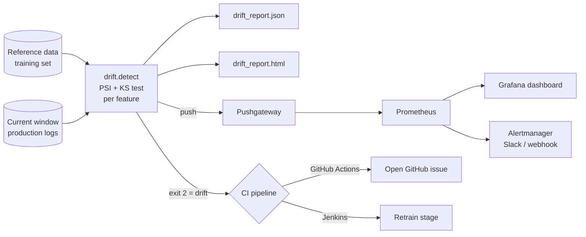

# ML CI/CD & Data Drift Monitoring


Models degrade silently when production data stops looking like the training data. This project **detects data drift automatically**, **reports it** (HTML, JSON, Prometheus metrics), **alerts** through Alertmanager and GitHub Issues, and **gates CI/CD**: a drift exit code can trigger retraining in Jenkins or GitHub Actions.

## How it works



### Drift logic

For every numeric feature:

| Metric | Meaning | Default threshold |
|--------|---------|-------------------|
| **PSI** (Population Stability Index) | How much the binned distribution moved | `> 0.2` |
| **KS test** (Kolmogorov–Smirnov) | Whether the two samples come from the same distribution | `p < 0.01` |

A feature is **drifted** when *both* conditions hold, which cuts false alarms. The **dataset drifts** when more than 25% of features drift. The CLI then exits with code `2`, so any CI system can react.

## Features

- 📊 **Statistical drift detection:** PSI on quantile bins plus a two-sample KS test, implemented with NumPy/SciPy and fully unit-tested.
- 📝 **Reports:** a JSON report for machines and a colour-coded HTML report for humans, uploaded as CI artifacts.
- 📈 **Observability:** gauges pushed to Prometheus Pushgateway, a provisioned **Grafana dashboard** and **alert rules** (dataset drift, severe feature drift, stale monitor job).
- 🤖 **GitHub Actions:** `ci.yml` (lint, tests, Docker build) and `drift-check.yml`, a **daily scheduled** drift check that **opens a GitHub issue** when drift is found.
- 🏗️ **Jenkins:** a declarative `Jenkinsfile` with a nightly cron, JUnit reports, archived drift reports and a conditional **Retrain** stage.
- 🐳 **Docker:** the detector ships as a container. The monitoring stack runs with one `docker compose up`.

## Project structure

```
ml-cicd-drift-monitoring/
├── drift/
│   ├── metrics.py      # PSI and KS implementations
│   ├── detect.py       # CLI: compare datasets → reports, metrics, exit code
│   └── simulate.py     # generate reference/current data with optional drift
├── tests/test_drift.py
├── monitoring/
│   ├── docker-compose.yml           # Pushgateway, Prometheus, Alertmanager, Grafana
│   ├── prometheus.yml  alert-rules.yml  alertmanager.yml
│   └── grafana/                     # provisioned datasource + "Data Drift Monitor" dashboard
├── Jenkinsfile
├── Dockerfile
└── .github/workflows/{ci.yml, drift-check.yml}
```

## Quick start

```bash
git clone https://github.com/Muhammad-HamzaShamsi/ml-cicd-drift-monitoring.git
cd ml-cicd-drift-monitoring
python -m venv .venv && source .venv/bin/activate
pip install -r requirements-dev.txt
pytest -q

# 1) No drift
python -m drift.simulate --out data --drift 0
python -m drift.detect --reference data/reference.csv --current data/current.csv
# Dataset drift: False

# 2) Inject drift into a third of the features
python -m drift.simulate --out data --drift 1
python -m drift.detect --reference data/reference.csv --current data/current.csv
# Dataset drift: True (share=32%)  → exit code 2, open reports/drift_report.html
```

### Run with the monitoring stack

```bash
cd monitoring && docker compose up -d && cd ..
python -m drift.detect --reference data/reference.csv --current data/current.csv \
       --pushgateway localhost:9091
```

| Service      | URL                    |
|--------------|------------------------|
| Grafana      | http://localhost:3000 (dashboard: *ML Monitoring → Data Drift Monitor*) |
| Prometheus   | http://localhost:9090  |
| Alertmanager | http://localhost:9093  |
| Pushgateway  | http://localhost:9091  |

### Trigger the scheduled check manually

GitHub → **Actions → Scheduled drift check → Run workflow**, and set `drift_level` to `1` to see an issue opened automatically.

## Using it with real data

Replace the *Prepare data* step (GitHub Actions) or the `drift.simulate` call (Jenkins) with an export of your inference logs. For example, query the last 24 hours of model inputs from your database into `data/current.csv`, and keep the training snapshot as `data/reference.csv`.

## Roadmap

- [ ] Prediction drift and concept drift (once labels arrive)
- [ ] Categorical features (chi-squared / Jensen–Shannon)
- [ ] Automatic retrain pull request against [mlops-end-to-end-pipeline](https://github.com/Muhammad-HamzaShamsi/mlops-end-to-end-pipeline)

## License

MIT © Muhammad Hamza Shamsi
